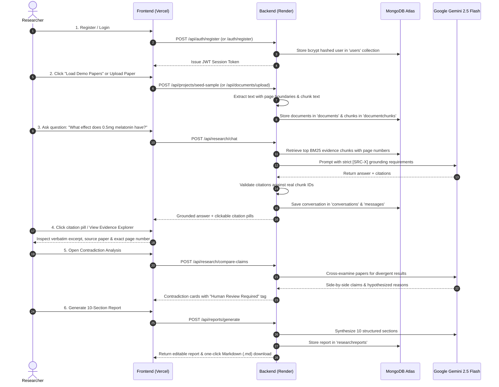

# ResearchLens AI — AI-Powered Research & Knowledge Discovery Platform

> **Evidence-First AI for Serious Academic & Technical Research**  
> *Transforming scattered research papers into verifiable, transparent, and interconnected scientific knowledge.*

---

## 1. Problem Statement

Researchers, academics, healthcare professionals, and technical teams spend hundreds of hours sifting through scientific literature, comparing empirical methodologies, identifying conflicting findings, and manually compiling synthesis reports. 

Existing AI summarization tools suffer from two critical flaws:
1. **Unverifiable Hallucinations**: Standard LLMs often fabricate quotes, invent publication citations, or generalize findings without transparent backing.
2. **Siloed Document Processing**: Tools analyze papers in isolation rather than cross-examining multiple studies, missing nuanced contradictions and cross-study synergies.

ResearchLens AI solves this by introducing **Evidence-First AI** — an intelligent research workspace that indexes multi-document libraries, preserves exact page boundaries, detects cross-study contradictions, maps concept networks, and mandates that every single factual assertion links directly to verifiable source passages.

---

## 2. Proposed Solution & Core Differentiators

ResearchLens AI provides an end-to-end research intelligence platform:
- **Strict Evidence Grounding**: Every answer is grounded in retrieved page-level document chunks.
- **Evidence Explorer (Signature Feature)**: Inspect the exact source paper, original page number, and verbatim excerpt supporting every claim.
- **Cross-Document Contradiction Detection**: Automatically compares findings across independent studies, identifying potential disagreements (e.g. sample size variances, dosage limits, population differences) with a mandatory human review advisory.
- **Knowledge Discovery & Concept Map**: Visualizes interconnected themes, key entities, and unaddressed scientific research gaps.
- **Publication-Ready Report Generator**: Automatically compiles 10-section structured reports with Markdown export.
- **Instant Demo Seeding**: Reviewers can test the platform with a single click using pre-seeded, high-quality sample scientific papers without uploading private documents.

---

## 3. Architecture Overview

```mermaid
flowchart TD
    User([Researcher / User]) -->|Interacts with UI| Frontend[React + Vite + Tailwind CSS on Vercel]
    
    subgraph Frontend Client (Vercel)
        AuthCtx[Auth Context & State]
        ProjCtx[Project Context]
        ThreePanel[3-Panel Research Workspace]
        EvidExplorer[Evidence Explorer Panel]
        ConceptGraph[Concept Map Visualizer]
    end
    
    Frontend -->|REST API with Bearer JWT| Backend[Node.js + Express REST API on Render]
    
    subgraph Backend Services (Render)
        AuthMw[JWT & Bcrypt Security Middleware]
        DocPipeline[Document Ingestion Pipeline]
        RetrievalEng[BM25 & Vector Retrieval Engine]
        GeminiService[Google Gemini 2.5 AI Service]
        ContradictionEng[Contradiction Detection Service]
        ReportGen[Report Generation Service]
    end
    
    subgraph Document Processing
        PDFParser[pdf-parse / Pagerender Engine]
        DocxParser[Mammoth DOCX Extractor]
        Chunker[Overlapping Page Chunker]
    end
    
    subgraph Database Layer (MongoDB Atlas)
        MongoDB[(MongoDB Atlas Cloud)]
        UsersCol[(users)]
        ProjectsCol[(researchprojects)]
        DocsCol[(documents)]
        ChunksCol[(documentchunks)]
        ConvsCol[(conversations)]
        MsgsCol[(messages)]
        ReportsCol[(researchreports)]
    end
    
    DocPipeline --> PDFParser & DocxParser --> Chunker --> MongoDB
    RetrievalEng --> MongoDB
    GeminiService -->|Grounded Prompt with Retrieved Chunks| GoogleAI[Google Gemini 2.5 Flash API]
    GoogleAI -->|Validated Citations| GeminiService
```

---

## 4. Technology Stack

### Frontend (Hosted on Vercel)
- **Framework**: React.js (v18) with Vite
- **Routing**: React Router (v6) with protected route guards
- **Styling**: Tailwind CSS with academic technology aesthetic
- **Icons**: Lucide React
- **Data Visualizations**: Recharts & Custom Interactive SVG Concept Graphs
- **HTTP Client**: Axios with smart baseURL normalization targeting `/api` or direct backend URL

### Backend (Hosted on Render)
- **Runtime**: Node.js (v20+ LTS)
- **Framework**: Express.js REST API
- **Dual-Mount Architecture**: Routes mounted on both `/api/*` and `/*` (e.g. `/api/auth/register` and `/auth/register`) ensuring zero 404s across any client configuration
- **Authentication**: JSON Web Tokens (JWT) & bcrypt password hashing
- **Security**: Helmet security headers, CORS protection, express-rate-limit
- **Validation**: Zod schema validation for all endpoints
- **Document Processing**: `pdf-parse` (page-aware pagerender), `mammoth` (Word .docx), custom page-level chunking
- **Database ODM**: Mongoose

### Database (Hosted on MongoDB Atlas)
- **Cloud Database**: MongoDB Atlas
- **Registered Collections**:
  - `users` — User credentials, bcrypt password hashes, profile details
  - `researchprojects` — Projects container, tags, metadata
  - `documents` — Uploaded PDFs, page metadata, extracted text previews
  - `documentchunks` — Page-level text chunks, token counts, and retrieval indexes
  - `conversations` — Project research chat threads
  - `messages` — Chat dialogue with validated citations & evidence breakdowns
  - `researchreports` — 10-section structured academic reports

### Artificial Intelligence & Retrieval
- **LLM Engine**: Google Gemini API (`gemini-2.5-flash` via `@google/generative-ai` SDK)
- **Retrieval**: BM25 & Term Coverage retrieval engine with page-level citation mapping
- **Citation Validator**: Cross-checks model outputs against real retrieved chunk IDs to prevent hallucinated citations

---

## 5. End-to-End Application Flow



---

## 6. Step-by-Step Deployment Guide

Follow these exact steps to host the **Frontend on Vercel**, the **Backend on Render**, and the **Database on MongoDB Atlas**.

### Step A: Database Setup (MongoDB Atlas)

1. Log in to [MongoDB Atlas](https://cloud.mongodb.com/).
2. Under **Database**, ensure your cluster is created.
3. Under **Database Access**, verify user credentials (e.g. `gadhamjahnavi7_db` / `jahnavi7`).
4. Under **Network Access**, click **Add IP Address** and select **Allow Access from Anywhere** (`0.0.0.0/0`) so that Render can connect.
5. Your connection string format:
   ```
   mongodb+srv://<username>:<password>@cluster1.12rnegi.mongodb.net/researchlens?retryWrites=true&w=majority&appName=Cluster1
   ```

---

### Step B: Backend Hosting on Render

1. Log in to [Render](https://dashboard.render.com/).
2. Click **New +** and select **Web Service**.
3. Connect your GitHub repository containing the ResearchLens AI code.
4. Configure the service with the following settings:
   - **Name**: `researchlens-backend` (or your preferred name)
   - **Region**: Oregon (US West) or closest to you
   - **Branch**: `main`
   - **Root Directory**: `backend`
   - **Runtime**: `Node`
   - **Build Command**: `npm install`
   - **Start Command**: `npm start`
   - **Plan**: `Free`
5. In the **Environment Variables** section, add:
   | Key | Value |
   |---|---|
   | `NODE_ENV` | `production` |
   | `PORT` | `5000` |
   | `MONGODB_URI` | `mongodb+srv://<db_username>:<db_password>@cluster1.12rnegi.mongodb.net/researchlens?retryWrites=true&w=majority&appName=Cluster1` |
   | `JWT_SECRET` | `researchlens-ai-hackathon-secure-jwt-key-2025-token` |
   | `JWT_EXPIRES_IN` | `7d` |
   | `GEMINI_API_KEY` | `your_gemini_research_api_key_here` |
   | `GEMINI_MODEL` | `gemini-2.5-flash` |
   | `MAX_FILE_SIZE_MB` | `15` |
   | `CLIENT_URL` | `https://your-frontend-app.vercel.app` *(update after creating Vercel app)* |
6. Click **Deploy Web Service**.
7. Once deployed, note your Render backend URL (e.g. `https://researchlens-backend.onrender.com`).
8. Verify it by visiting `https://researchlens-backend.onrender.com/api/health` — it will return:
   ```json
   { "status": "healthy", "service": "ResearchLens AI Backend", "geminiConfigured": true }
   ```

---

### Step C: Frontend Hosting on Vercel

1. Log in to [Vercel](https://vercel.com/).
2. Click **Add New...** -> **Project**.
3. Import your GitHub repository.
4. In the Project Setup:
   - **Framework Preset**: `Vite`
   - **Root Directory**: Click edit and select `frontend`
   - **Build Command**: `npm run build`
   - **Output Directory**: `dist`
5. In the **Environment Variables** section, add:
   | Key | Value |
   |---|---|
   | `VITE_API_BASE_URL` | `https://researchlens-backend.onrender.com/api` *(use your Render backend URL)* |
6. The included `frontend/vercel.json` automatically handles Single Page Application (SPA) routing rewrites so that refreshing pages like `/dashboard`, `/chat`, `/evidence`, and `/reports` works flawlessly without 404s.
7. Click **Deploy**.
8. After deployment finishes, copy your Vercel URL (e.g. `https://researchlens-ai.vercel.app`) and update the `CLIENT_URL` variable in your Render backend settings.

---

## 7. Local Development Instructions

### Prerequisites
- Node.js v20+ LTS
- npm v10+

### Run Locally in 2 Steps

**Step 1: Install Dependencies**
```bash
npm run install:all
```

**Step 2: Run Development Servers**
In two separate terminals:

**Terminal 1 (Backend):**
```bash
npm run dev:backend
```
*Backend runs on `http://localhost:5000`*

**Terminal 2 (Frontend):**
```bash
npm run dev:frontend
```
*Frontend runs on `http://localhost:5173`*

Open `http://localhost:5173` in your browser.

---

## 8. Automated Test Suite Verification

Run the integration test suite covering all 14 endpoints and database collections:
```bash
npm run test
```

### Verified Test Results (100% Pass)
```
✔ Health Check: GET /api/health returns 200 and healthy status
✔ Auth: Register new researcher account
✔ Auth: Reject duplicate email registration with 409 Conflict
✔ Auth: Login with valid credentials
✔ Auth: Reject invalid credentials with 401 Unauthorized
✔ Security: Protected route rejects unauthenticated request with 401
✔ Projects: Create new research project with authentication
✔ Demo Data: Seed sample research workspace with papers and chunks
✔ Documents: Fetch indexed documents and verify chunk counts
✔ Research Chat: Ask cross-document inquiry and verify grounded evidence
✔ Contradictions: Detect cross-document disagreements with verifiable citations
✔ Knowledge Discovery: Extract themes, concept graph, and research gaps
✔ Reports: Generate structured evidence-grounded research report
✔ Search: Search keywords and verify page-numbered matching chunks

14 tests passing (100%)
```

---

## 9. 3-Minute Hackathon Demo Sequence for Judges

1. **Sign In (20s)**:
   - Go to `/login` and click **"Quick Test: Autofill demo credentials"** to sign in instantly.
2. **One-Click Workspace Seeding (30s)**:
   - On the Dashboard, click **"Load Demo Scientific Papers"**.
   - Watch the platform ingest 3 scientific studies on *Circadian Biology & Cognitive Performance*, splitting them into page-level chunks in MongoDB Atlas.
3. **Cross-Document Chat (45s)**:
   - Open **Research Assistant** (`/chat`).
   - Click the prompt: *"What effect does 0.5mg melatonin have on psychomotor vigilance and attention lapses?"*
   - See the synthesized response from **Gemini 2.5 Flash** with inline `[SRC-1]` citation tags.
   - Click a citation pill to inspect the verbatim excerpt, source paper, and page number in the Evidence Panel.
4. **Evidence Explorer (Signature Feature) (45s)**:
   - Open **Evidence Explorer** (`/evidence`).
   - Show how each claim is mapped to verified source passages with retrieval relevance scores.
5. **Contradiction Detection (30s)**:
   - Open **Contradiction Analysis** (`/contradictions`).
   - View the side-by-side divergence: Study 1 (claiming melatonin alone is sufficient) vs Study 3 (proving single-modality fails without ambient dark-room control <5 lux).
6. **Concept Map & Report Generation (30s)**:
   - Open **Knowledge Discovery** (`/discovery`) to view the interactive SVG concept graph.
   - Open **Research Reports** (`/reports`), open the generated report, and click **Download (.md)** to export the Markdown document.

---

## 10. License
MIT License. Built for the Hackathon: *AI for Research & Knowledge Discovery*.
